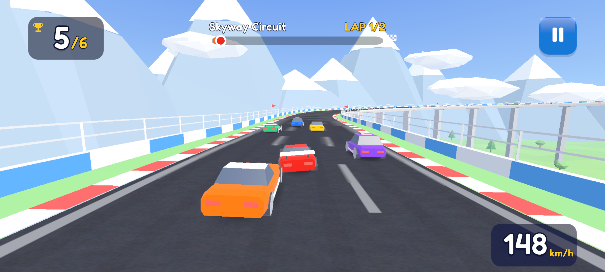

# Turbo Rush 3D

A bright, child-friendly 3D arcade racer for Android phones and tablets. The car **accelerates by itself**;
the player **holds the left or right half of the screen to steer**. Offline, no ads, no accounts, no tracking.

- Engine: **Unity 6000.3.27f2**, URP 17.3 (lean custom shaders), Input System, uGUI + TextMeshPro
- Platform: Android, landscape, IL2CPP, **ARMv7 + ARM64**, Vulkan with a **PowerVR → OpenGL ES 3 deny filter**
- Baseline device: Redmi A3 (32-bit Android, PowerVR GE8320)



## Controls
| Input | Action |
|---|---|
| Hold left half of screen | steer left |
| Hold right half of screen | steer right |
| Release | steering returns smoothly to centre |
| Pause button (top-right) / Android Back / Esc | pause |
| Editor/desktop | mouse button on either half, or ←/→ (A/D) |

## Content
- Tracks: **Skyway Circuit** (elevated skyway, first/tutorial), **Desert Dash** (banked turns, rock tunnel, unlock at 2 ★),
  **Coastal Loop** (island loop, bridge over a channel, sandy runoff, unlock at 4 ★). 2 laps each, about 75–95 s per race.
- 8 original stylised cars in three body styles. **Blaze** is owned from the start; the others unlock at 1–9 ★.
  Cars are cosmetic: every car has the same handling, so nothing can be bought or grinded into an advantage.
- Stars per race: 1st = 3 ★, 2nd–3rd = 2 ★, any finish = 1 ★. The best result per track counts (max 9 ★).

## Project layout
```
Assets/
  Scripts/Runtime/   Core (services, state machine, config, autopilot) · Race (simulation, manager, tuning)
                     Track (path sampler, definition, mesh/scenery builders) · Vehicle · AI · Input · Camera
                     UI · Audio · Save · Platform (quality, haptics)
  Editor/            ProjectConfigurator, BuildScript, BuildValidator, ProjectSetup + content generators
                     (ArtBuilder, IconPainter, CarBuilder, TrackDataBuilder, AudioSynth, SceneBuilder)
  Tests/EditMode     sampler, motor, race rules, recovery, AI completion, save/migration, progression, UI maths
  Tests/PlayMode     race scene: countdown, pause/resume, HUD, finish, results, restart
  ScriptableObjects/ Cars, Tracks, AI, UISkin, AudioLibrary   ·   Resources/GameConfig.asset (root config)
  Settings/          URP assets (TR_Low/Medium/High) and VulkanDeviceFilters.asset
  Art/ Audio/ Prefabs/ Scenes/ (Boot, Menu, Race)
Tools/               shell entry points (below)
Docs/                screenshots, validation evidence, Redmi A3 checklist
```
Art, audio, cars, tracks, UI sprites and scenes are **generated** by `Tools/setup.sh`
(**Tools ▸ Turbo Rush ▸ Setup Project**). Change the generator, then regenerate; don't hand-edit generated assets.
Track geometry and scenery are built at load time from each `TrackDefinition`.

## Adding a track
1. Create a `TrackDefinition` (Assets ▸ Create ▸ Turbo Rush ▸ Track Definition), or add a method to `TrackDataBuilder`.
2. Fill in the looping control points (metres), laps, road widths, theme palette, optional tunnels, bridges
   and open-runoff ranges, scenery counts and unlock stars.
3. Add it to `GameConfig.tracks`. Run **Validate Project**, which checks lap length and that no corner is tighter than 30 m.
   Then run the EditMode tests. `AIOpponentsCompleteEveryShippedTrack` checks that every racer finishes in 50–130 s.

No race code changes are needed.

## Commands (Linux, from the repo root)
| Command | What it does |
|---|---|
| `Tools/setup.sh` | Regenerate all content and validate (`Logs/setup.log`) |
| `Tools/run_tests.sh [EditMode\|PlayMode\|all]` | Batch tests → `Logs/*-results.xml` |
| `Tools/build_android.sh [release]` | Development (default) or release APK, then `verify_apk.sh` |
| `Tools/verify_apk.sh <apk>` | Independent check: both ABIs, PowerVR filter packaged, landscape, no INTERNET in release |
| `Tools/build_linux.sh` | Desktop test player |
| `Tools/autopilot.sh [WxH[:inset] …]` | Automated play-through + screenshots (`Logs/AutoPilot/`). Env: `TR_TRACK`, `TR_FAST=1`, `TR_QUALITY=Low` |

Only one Unity Editor process may open the project at a time. Menu equivalents are under **Tools ▸ Turbo Rush**:
Configure Android, Build Development APK, Build Release APK, Validate Build, Validate Project, Setup Project.

## Build outputs
- `Builds/Android/TurboRush3D.apk` (release) and `Builds/Android/TurboRush3D-dev.apk` (development, with profiler)
- `<apk>.validation.txt` is written next to each APK by `BuildValidator`
- Install: `adb install -r Builds/Android/TurboRush3D.apk`. The release APK is signed with the Android debug keystore,
  which is fine for sideloading and testing. Set up an upload keystore before any store submission.

## Testing on the Redmi A3
Follow [`Docs/REDMI_A3_TEST_CHECKLIST.md`](Docs/REDMI_A3_TEST_CHECKLIST.md), including the mandatory
full-close/relaunch regression.

See also: [`PROJECT_STATUS.md`](PROJECT_STATUS.md) · [`BUILD_VALIDATION.md`](BUILD_VALIDATION.md) · [`CHANGELOG.md`](CHANGELOG.md)

## Licences
All code, meshes, textures, icons and audio are original and generated in this project. The font is Fredoka
(SIL Open Font License; see `Assets/Art/UI/Fonts/OFL.txt`). TextMesh Pro essentials are Unity package content.
